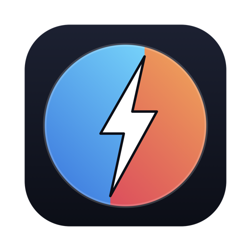
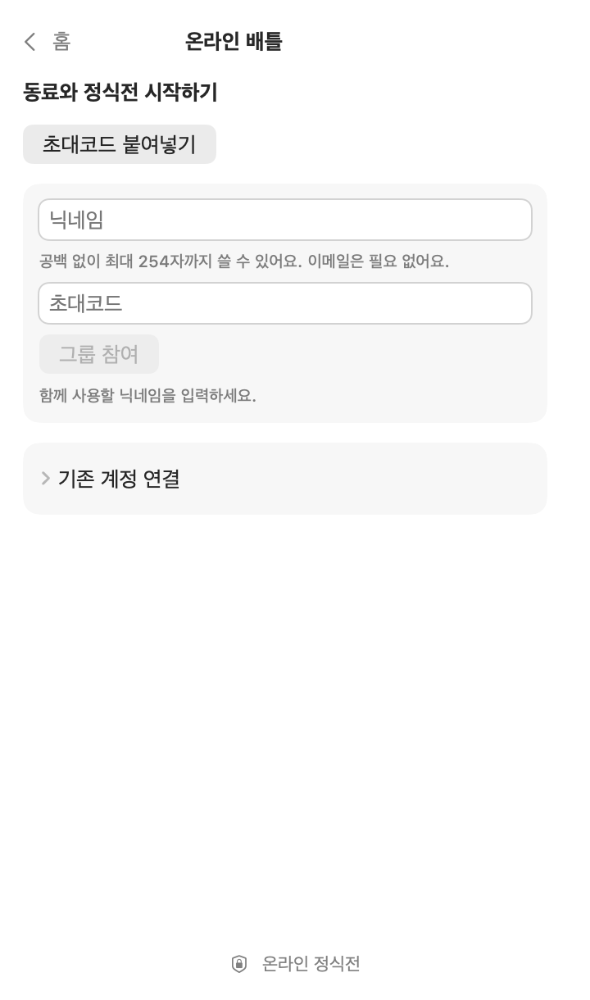
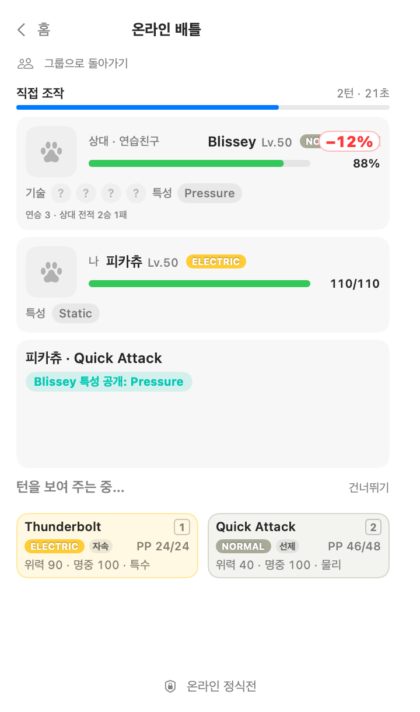
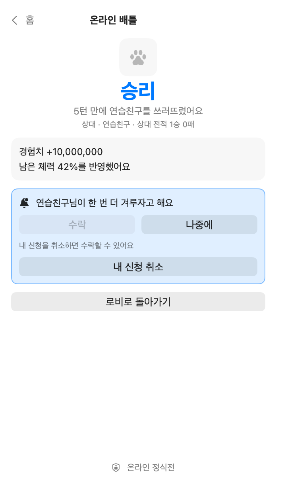
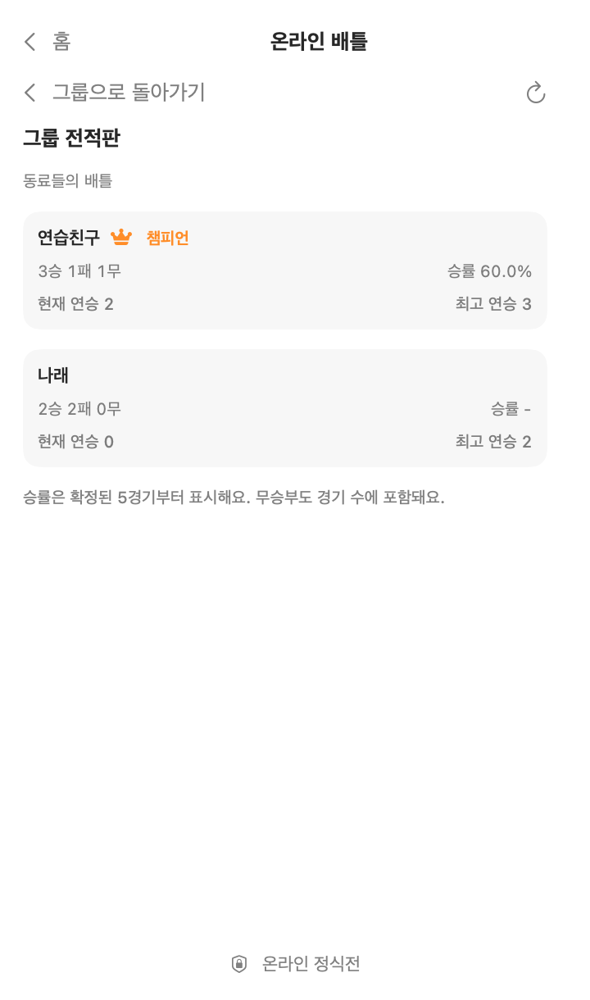
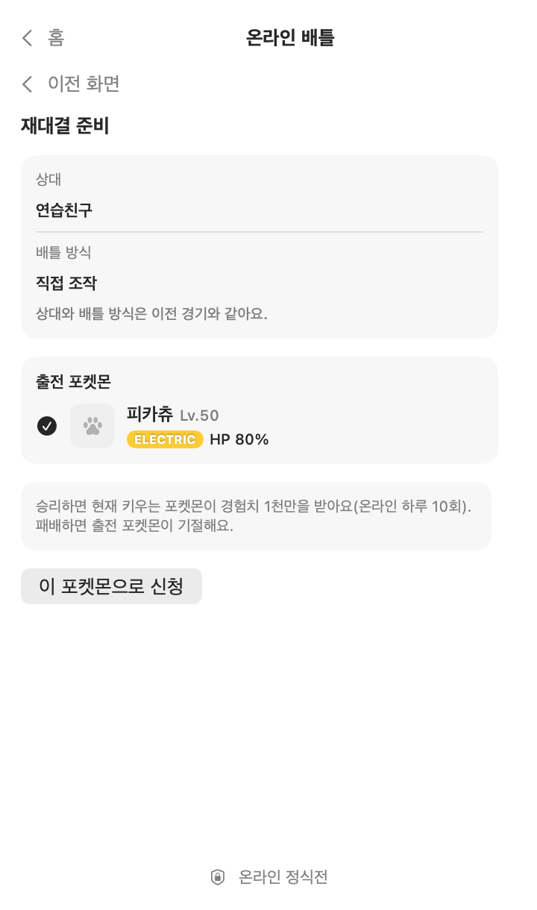
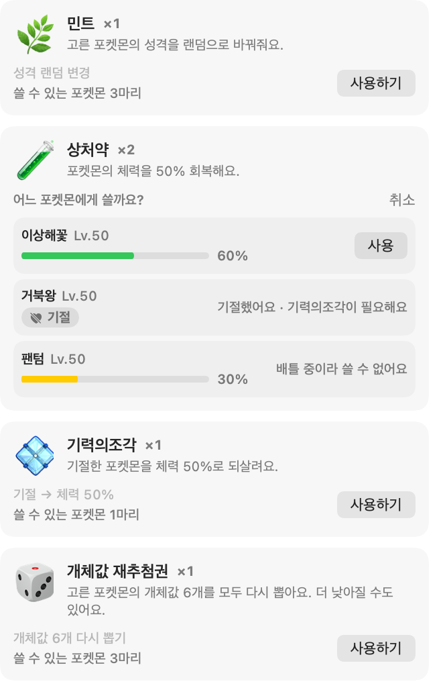
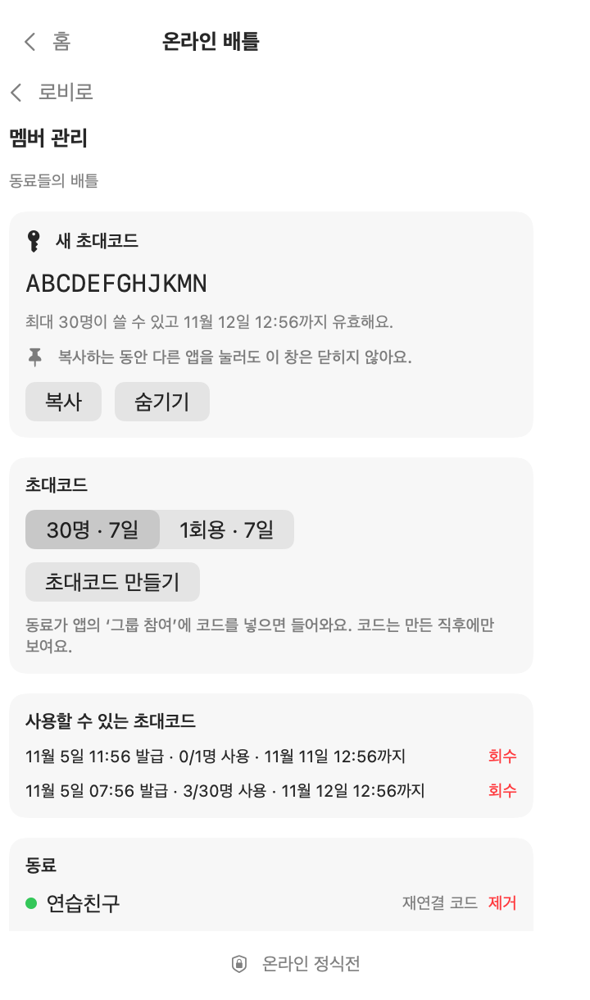

<div align="center">



# PokeTokenBattle

**AIコーディングのトークンでポケモンを育て、育てたポケモンで1対1のバトルをする macOS メニューバーゲーム**

[](https://github.com/dding94/poketokenbar-battle/releases/latest)
[](https://www.apple.com/macos/)
[](LICENSE)

[한국어](README.md) · **日本語**

</div>

> **非公式ファンプロジェクト:** PokeTokenBattle は任天堂、ゲームフリーク、クリーチャーズ、株式会社ポケモン、元の PokeTokenBar とは関係がなく、承認・後援を受けていません。

いつもどおり AI コーディングツールを使うと、メニューバーのタマゴがかえり、ポケモンが育ちます。育てたポケモンで一人で練習戦をしたり、招待された人たちとオンラインの正式戦をしたりできます。バトルに負けてもポケモンを奪われることはありません。

練習戦とオンライン対戦の画面は韓国語と英語で表示されます。以下では英語の画面名を示します。

## インストール

**macOS 15 以降**、Apple Silicon と Intel に対応しています。

```bash
brew install --cask dding94/tap/poke-token-bar-battle
open -a "PokeTokenBattle"
```

Homebrew を使わない場合は、[リリースページ](https://github.com/dding94/poketokenbar-battle/releases/latest)から `PokeTokenBarBattle.zip` をダウンロードし、`PokeTokenBattle.app` を `/Applications` に移動してください。

**初回起動がブロックされたら:** 自己署名アプリで、Apple の公証は受けていません。[Apple の案内](https://support.apple.com/ja-jp/102445)に従い、システム設定 → プライバシーとセキュリティで**このまま開く**を押してください。証明書のインストールや Gatekeeper の無効化は不要です。

**アップデート:** アプリ内のアップデートボタンか、次のコマンドを使います。Homebrew でインストールしていない場合、アップデートボタンはリリースページを開きます。

```bash
brew update
brew upgrade --cask poke-token-bar-battle
```

## 育てる

別途動かすものはありません。[対応ツール](#対応ツール)で使ったトークンが、そのまま経験値とショップの通貨になります。

1. 🥚 **孵化**: トークンがたまるとタマゴがかえります。第1〜5世代のポケモンがレア度に応じて生まれ、ごくまれに ✨ 色違いが生まれます。
2. ⚡ **進化**: 使い続けると実際の進化ツリーに沿って育ちます。
3. 🎓 **卒業と収集**: 最終進化のあと一定量を満たすと**図鑑**に永久保存され、新しいタマゴが届きます。
4. 🍬 **ふしぎなアメ**: 5時間の利用上限を使い切ると1個、週間上限を使い切ると5個もらえます。
5. 🛒 **ショップ**: 使ったトークンでアメ、回復アイテム、ミント、ひかるおまもり、タマゴを買えます。

パートナーをデスクトップに出すフローティングペットや、フォーム収集もあります。今日のトークン量と公式の上限はメニューバーですぐ確認できます。

## 練習戦

メニューバーのアイコンを押してホームの **Practice** を開き、自分のポケモンと相手を選ぶと始まります。

| 相手 | HP・ひんし | 勝利報酬 |
|---|---|---|
| 野生、今日の相手 | セーブに反映 | 現在のポケモンに経験値500万(1日10勝まで) |
| 自分のポケモン同士のスパーリング | 変化なし | なし |

- **手動操作**: 技カードか 1〜4 キーで選びます。15秒たつと自動で選択します。ポップオーバーを閉じるとタイマーが止まり、開き直すと続きから再開します。
- **自動進行**: ポップオーバーを閉じても進行します。
- **メニューバーの表示**: `⚔︎` 進行中、`⚑` 結果の確認待ち、`✚` 現在のポケモンがひんし。

## オンライン対戦

招待制です。ホストから**招待コード**を受け取ると参加できます。コードがなくても、育成と練習戦はそのまま楽しめます。

1. ホームで **Online battle** を開き、ニックネームと招待コードを入力して **Join group** を押します。参加直後に表示される**復旧コード**はコピーして保管してください。
2. ロビーで相手に正式戦を申し込みます。承諾、最終確認、戦闘準備を経て始まります。
3. 申し込むときに**手動操作**(1ターン30秒、時間切れで自動選択)か**自動バトル**を選びます。
4. 勝つと現在のポケモンが経験値1000万を得ます(オンラインは1日10勝まで)。負けると出場したポケモンがひんしになり、この結果は**実際のセーブに保存されます**。引き分けは双方の残りHPだけを反映します。

知っておくとよいこと:

- 第9世代ルール(テラスタルなし)で戦い、ポケモンの現在のレベル・個体値・性格・特性・覚えている技をそのまま使います。相手の技と特性は最初に使われたときに公開されます。
- ポップオーバーを閉じていても、メニューバーの表示と macOS 通知で申し込みと自分の番を知らせます。
- Keychain へのアクセスを無効にする設定がオンだと、オンライン接続は中断されます。
- **ホスト**にはロビーに **Manage members** が表示されます。招待コードの発行と回収、メンバーの削除、接続キーを失った人への再接続コード発行をアプリ内で行います。

## 回復とアイテム

自然回復はありません。ひんしのポケモンは、回復するまで野生・今日の相手・正式戦に出られません。ショップで買って**バッグ**で使います。ふしぎなアメは現在のポケモンに、それ以外は手持ちのポケモンから対象を選んで使います。

| アイテム | 効果 | 基本価格(トークン) |
|---|---|---|
| キズぐすり | HPを50%回復 | 1億 |
| すごいキズぐすり | HPを全回復 | 3億 |
| げんきのかけら | ひんしのポケモンをHP50%で復活 | 4億 |
| ミント | 性格を引き直し | 1億 |
| 個体値リロール券 | 個体値6つを引き直し(下がることもあります) | 4億 |
| ふしぎなアメ | 経験値1億 | 5億 |

価格は設定のショップ価格倍率によって変わります。

## 画面

サンプルデータで描いた韓国語の画面です。ポケモンの絵は灰色のアイコンに置き換えています。実際のアプリではスプライトが表示されます。

<table>
<tr>
<td align="center"><br>参加</td>
<td align="center"><br>対戦</td>
<td align="center"><br>結果と再戦</td>
</tr>
<tr>
<td align="center"><br>グループ戦績表</td>
<td align="center"><br>出場準備</td>
<td align="center"><br>バッグ</td>
</tr>
<tr>
<td align="center"><br>ホストのメンバー管理</td>
<td></td>
<td></td>
</tr>
</table>

## 対応ツール

Claude Code · Codex · Gemini CLI · Antigravity · OpenCode · Hermes Agent · Cursor · Grok CLI · Copilot CLI · Kiro CLI · Pi Agent · omp · Aside · Kimi Code

## セーブとプライバシー

- セーブは `~/Library/Application Support/PokeTokenBarBattle` にあります。大切なセーブはバックアップしてください。元の PokeTokenBar のセーブがあれば初回起動時に一度だけコピーし、元のアプリとセーブには手を加えません。
- トークン使用量はこの Mac のローカル記録から読み取ります。利用記録やプロンプトはゲームサーバーに送りません。オンライン対戦では、ニックネーム、出場するポケモンの情報、選んだ技、試合結果がサーバーを経由します。
- スプライトと名前の翻訳は実行時に [PokéAPI](https://pokeapi.co/) からダウンロードし、アプリには含めません。オフラインのときは代替画像を表示します。
- アプリが読み取るファイルと接続先の一覧は[ベースアプリの文書](README.upstream.md#data-sources)にあります。

## ライセンス & 免責

**MIT** — [LICENSE](LICENSE) を参照。MIT は本プロジェクトの**オリジナルソースコードのみ**を対象とし、アプリがアクセスする第三者の商標・画像・データに関する権利を付与するものではありません。

PokeTokenBattle は [PokeTokenBar](https://github.com/chattymin/PokeTokenBar) をベースにした**非公式・非商用のファンプロジェクト**です。**任天堂、ゲームフリーク、クリーチャーズ、株式会社ポケモンとの提携・推奨・後援・承認はありません。**「ポケモン(Pokémon)」および関連する名称・キャラクター・画像は各権利者の商標および著作物であり、本プロジェクトはポケモンの知的財産に対する権利を一切主張しません。

PokeTokenBattle is an **unofficial, non-commercial fan project** based on PokeTokenBar. It is **not affiliated with, endorsed, sponsored, or approved by Nintendo, Game Freak, Creatures Inc., or The Pokémon Company.** "Pokémon" and all related names, characters, and imagery are trademarks and copyrights of their respective owners. This project claims no ownership of, and asserts no rights over, any Pokémon intellectual property.
