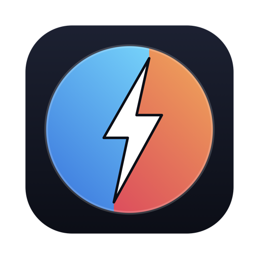
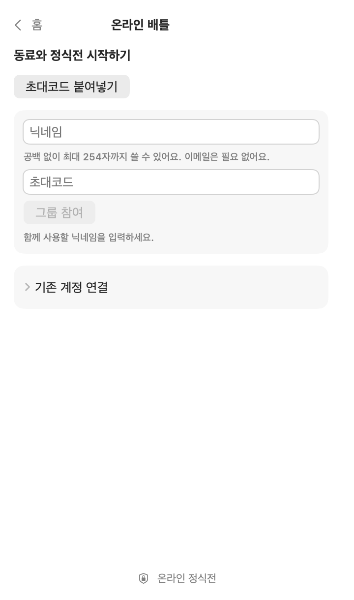
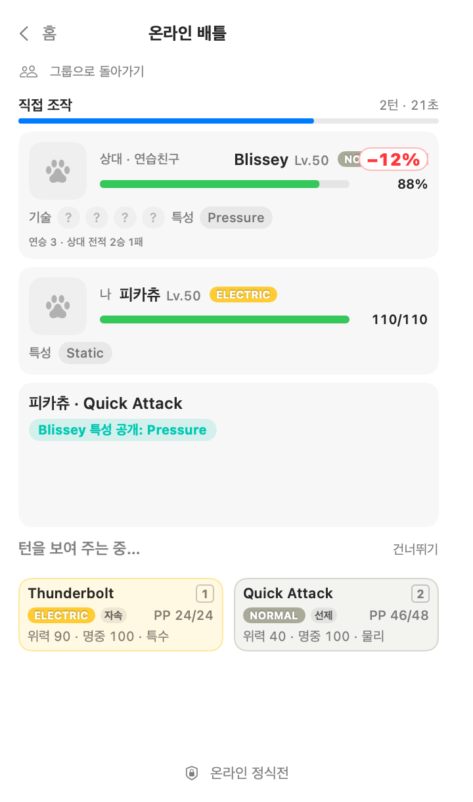
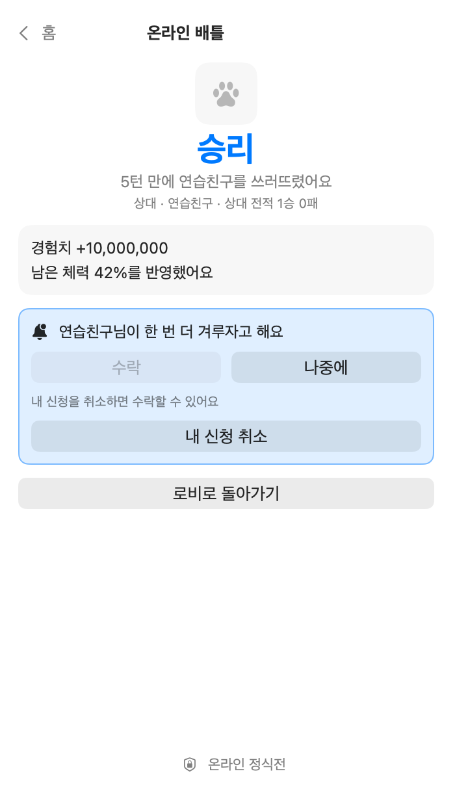
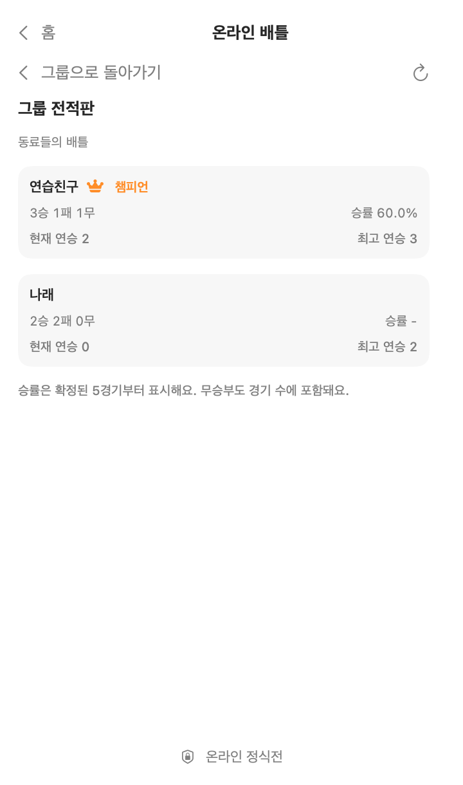
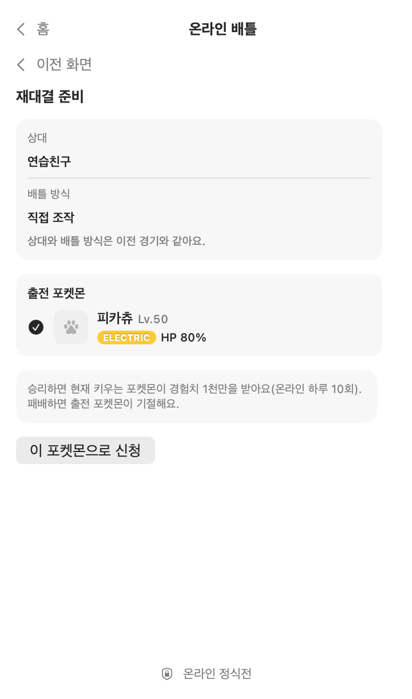
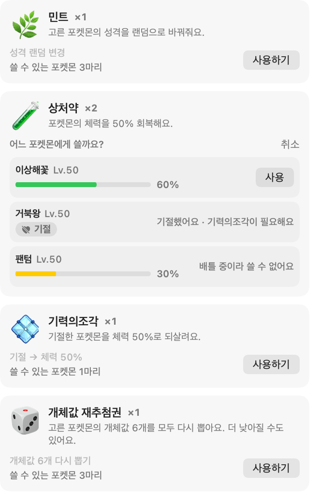
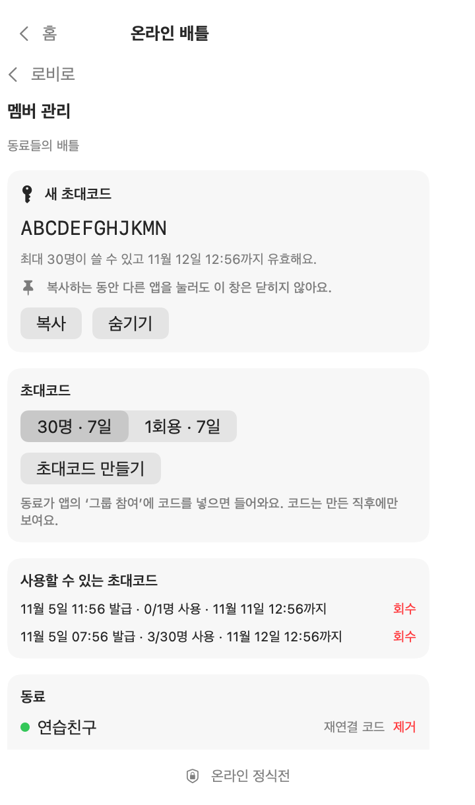

<div align="center">



# PokeTokenBattle

**AI 코딩 토큰으로 포켓몬을 키우고, 키운 포켓몬으로 1:1 배틀을 하는 macOS 메뉴바 게임**

[](https://github.com/dding94/poketokenbar-battle/releases/latest)
[](https://www.apple.com/macos/)
[](LICENSE)

**한국어** · [日本語](README.ja.md)

</div>

> **비공식 팬 프로젝트:** PokeTokenBattle은 Nintendo, Game Freak, Creatures Inc., The Pokémon Company 및 원본 PokeTokenBar와 무관하며 이들의 승인·후원을 받지 않았습니다. / Unofficial fan project, not affiliated with The Pokémon Company, Nintendo or the original PokeTokenBar.

평소처럼 AI 코딩 도구를 쓰면 메뉴바의 알이 부화하고 포켓몬이 자랍니다. 키운 포켓몬으로 혼자 연습전을 하거나, 초대받은 사람들과 온라인 정식전을 벌일 수 있습니다. 배틀에 져도 포켓몬을 빼앗기지 않습니다.

## 설치

**macOS 15 이상**, Apple Silicon·Intel을 지원합니다.

```bash
brew install --cask dding94/tap/poke-token-bar-battle
open -a "PokeTokenBattle"
```

Homebrew를 쓰지 않으면 [릴리스 페이지](https://github.com/dding94/poketokenbar-battle/releases/latest)에서 `PokeTokenBarBattle.zip`을 받아 `PokeTokenBattle.app`을 `/Applications`로 옮기세요.

**첫 실행이 막히면:** 자체 서명 앱이고 Apple 공증은 받지 않았습니다. [Apple 안내](https://support.apple.com/en-gb/102445)대로 시스템 설정 → 개인정보 보호 및 보안에서 **그래도 열기**를 누르세요. 인증서를 따로 설치하거나 Gatekeeper를 끌 필요는 없습니다.

**업데이트:** 앱 안의 업데이트 버튼이나 아래 명령을 쓰세요. Homebrew로 설치하지 않았다면 업데이트 버튼은 릴리스 페이지를 엽니다.

```bash
brew update
brew upgrade --cask poke-token-bar-battle
```

## 키우기

따로 돌릴 것은 없습니다. [지원 도구](#지원-도구)에서 쓴 토큰이 곧 경험치이자 상점 재화입니다.

1. 🥚 **부화**: 토큰이 쌓이면 알이 부화합니다. 1~5세대 포켓몬이 희귀도에 따라 나오고, 아주 드물게 ✨ 이로치가 태어납니다.
2. ⚡ **진화**: 계속 쓰면 실제 진화 트리를 따라 자랍니다.
3. 🎓 **졸업과 수집**: 최종 진화 후 일정량을 더 채우면 **도감**에 영구 보존되고 새 알이 옵니다.
4. 🍬 **이상한 사탕**: 5시간 사용량 한도를 다 채우면 1개, 주간 한도를 다 채우면 5개를 받습니다.
5. 🛒 **상점**: 쓴 토큰으로 사탕, 회복약, 민트, 이로치 부적, 알을 삽니다.

파트너를 바탕화면에 꺼내 두는 플로팅 펫과 폼 수집도 있습니다. 오늘 쓴 토큰과 공식 한도는 메뉴바에서 바로 볼 수 있습니다.

## 연습전

메뉴바 아이콘을 눌러 홈의 **연습전**을 열고, 내 포켓몬과 상대를 고르면 시작합니다.

| 상대 | 체력·기절 | 승리 보상 |
|---|---|---|
| 야생, 오늘의 상대 | 세이브에 반영 | 현재 포켓몬 경험치 500만 (하루 10승까지) |
| 내 포켓몬끼리 스파링 | 변화 없음 | 없음 |

- **직접 조작**: 기술 카드나 1~4 키로 고릅니다. 15초가 지나면 자동으로 선택합니다. 팝오버를 닫으면 타이머가 멈추고, 다시 열면 이어집니다.
- **자동 진행**: 팝오버를 닫아도 계속 진행합니다.
- **메뉴바 표식**: `⚔︎` 진행 중, `⚑` 결과 확인 전, `✚` 현재 포켓몬 기절.

## 온라인 배틀

초대제입니다. 방장에게 **초대코드**를 받아야 참여할 수 있습니다. 코드가 없어도 키우기와 연습전은 그대로 즐길 수 있습니다.

1. 홈에서 **온라인 배틀**을 열고 **닉네임**과 **초대코드**를 넣은 뒤 **그룹 참여**를 누릅니다. 가입 직후 보이는 **복구코드**는 복사해 두세요.
2. 로비에서 상대에게 정식전을 신청합니다. 수락, 최종 확인, 전투 준비를 거쳐 시작합니다.
3. 신청할 때 **직접 조작**(턴당 30초, 시간이 지나면 자동 선택)이나 **자동 배틀**을 고릅니다.
4. 이기면 현재 포켓몬이 경험치 1천만을 받습니다(온라인 하루 10승까지). 지면 출전한 포켓몬이 기절하고, 이 결과는 **실제 세이브에 저장됩니다**. 무승부면 양쪽의 남은 체력만 반영합니다.

알아 두면 좋은 점:

- 9세대 규칙(테라스탈 없음)으로 겨루며, 포켓몬의 현재 레벨·개체값·성격·특성·배운 기술을 그대로 씁니다. 상대의 기술과 특성은 처음 쓰일 때 공개됩니다.
- 팝오버를 닫아 둬도 메뉴바 표식과 macOS 알림으로 신청과 내 차례를 알려 줍니다.
- Keychain 접근 비활성화 설정이 켜져 있으면 온라인 연결이 중단됩니다.
- **방장**에게는 로비에 **멤버 관리**가 보입니다. 초대코드 발급·회수, 멤버 제거, 접속키를 잃은 사람의 재연결 코드 발급을 앱 안에서 합니다.

## 회복과 아이템

자연 회복은 없습니다. 기절한 포켓몬은 회복해야 야생·오늘의 상대·정식전에 나갈 수 있습니다. 상점에서 사서 **가방**에서 씁니다. 이상한 사탕은 현재 포켓몬에게, 나머지는 보유한 포켓몬 중 대상을 골라 씁니다.

| 아이템 | 효과 | 기본 가격(토큰) |
|---|---|---|
| 상처약 | 체력 50% 회복 | 1억 |
| 고급상처약 | 체력 전부 회복 | 3억 |
| 기력의조각 | 기절한 포켓몬을 체력 50%로 부활 | 4억 |
| 민트 | 성격 다시 뽑기 | 1억 |
| 개체값 재추첨권 | 개체값 6개 다시 뽑기 (낮아질 수 있음) | 4억 |
| 이상한 사탕 | 경험치 1억 | 5억 |

가격은 설정의 상점 가격 배율에 따라 달라집니다.

## 화면

샘플 데이터로 그린 화면입니다. 포켓몬 그림은 회색 아이콘으로 대체했고, 실제 앱에서는 스프라이트가 표시됩니다.

<table>
<tr>
<td align="center"><br>가입</td>
<td align="center"><br>대전</td>
<td align="center"><br>결과와 재대결</td>
</tr>
<tr>
<td align="center"><br>그룹 전적판</td>
<td align="center"><br>출전 준비</td>
<td align="center"><br>가방</td>
</tr>
<tr>
<td align="center"><br>방장의 멤버 관리</td>
<td></td>
<td></td>
</tr>
</table>

## 지원 도구

Claude Code · Codex · Gemini CLI · Antigravity · OpenCode · Hermes Agent · Cursor · Grok CLI · Copilot CLI · Kiro CLI · Pi Agent · omp · Aside · Kimi Code

## 세이브와 개인정보

- 세이브는 `~/Library/Application Support/PokeTokenBarBattle`에 있습니다. 소중한 세이브는 백업해 두세요. 원본 PokeTokenBar 세이브가 있으면 첫 실행 때 한 번 복사해 오며, 원본 앱과 세이브는 건드리지 않습니다.
- 토큰 사용량은 이 맥의 로컬 기록에서 읽습니다. 사용 기록과 프롬프트는 게임 서버로 보내지 않습니다. 온라인 배틀에서는 닉네임, 출전 포켓몬 정보, 선택한 기술, 경기 결과가 서버를 거칩니다.
- 스프라이트와 이름 번역은 실행 중 [PokéAPI](https://pokeapi.co/)에서 내려받으며 앱에 포함하지 않습니다. 오프라인이면 대체 그림을 표시합니다.
- 앱이 읽는 파일과 접속하는 서비스의 전체 목록은 [원본 앱 문서](https://github.com/chattymin/PokeTokenBar/blob/v2.5.6/README.md#data-sources)에 있습니다.

## 라이선스와 고지

**MIT** — [LICENSE](LICENSE). MIT 라이선스는 이 프로젝트의 원본 소스 코드에만 적용되며, 앱이 접근하는 제3자 상표·이미지·데이터에 대한 권리를 부여하지 않습니다.

PokeTokenBattle은 [PokeTokenBar](https://github.com/chattymin/PokeTokenBar)를 기반으로 한 **비공식·비상업 팬 프로젝트**입니다. Nintendo, Game Freak, Creatures Inc., The Pokémon Company와 관련이 없으며 이들의 승인·후원을 받지 않았습니다. "Pokémon"과 관련 이름·캐릭터·이미지는 각 권리자의 상표이자 저작물이며, 이 프로젝트는 Pokémon 지식재산에 대한 어떤 권리도 주장하지 않습니다.

PokeTokenBattle is an **unofficial, non-commercial fan project** based on PokeTokenBar. It is **not affiliated with, endorsed, sponsored, or approved by Nintendo, Game Freak, Creatures Inc., or The Pokémon Company.** "Pokémon" and all related names, characters, and imagery are trademarks and copyrights of their respective owners. This project claims no ownership of, and asserts no rights over, any Pokémon intellectual property.
